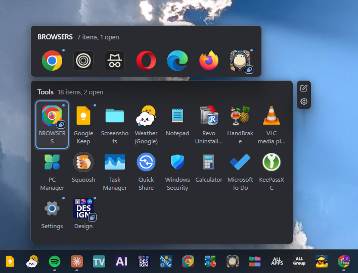
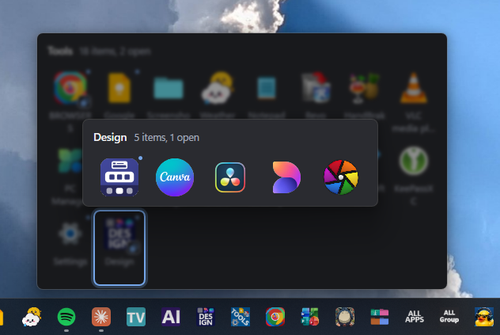
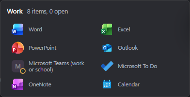
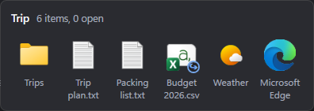
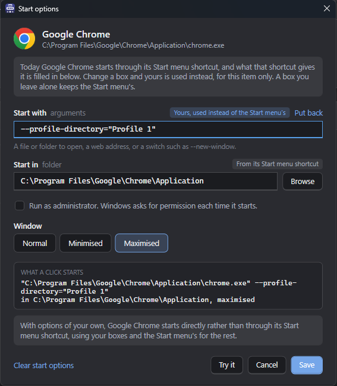
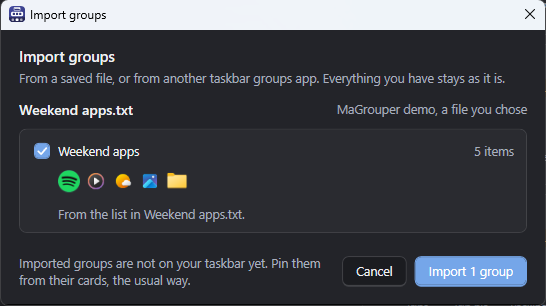
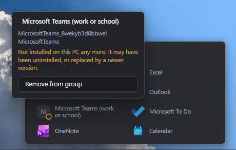

<p align="center">
  
</p>

<h1 align="center">MaGrouper - Windows Taskbar Groups</h1>

<p align="center">
  Fold a crowded Windows 11 taskbar into a few group icons.<br> Click one, and the apps inside fan out with live previews of their windows.
</p>

<p align="center">
  
  
  
  
  
</p>

<p align="center">
  <a href="../../releases/latest"><b>Download for Windows 11</b></a>
  &nbsp;&middot;&nbsp;
  <a href="../../releases">Release notes</a>
</p>

<p align="center">
  One file, about 47 MB. No .NET to install, no account, no telemetry.
</p>

<p align="center">
  
</p>

<p align="center">
  <sub>One click on a group icon. Recorded on a real Windows 11 taskbar.</sub>
</p>

---

## What it is for

Windows 11 gives you one row for pinned apps and no folders. Pin everything you use and the row runs out of taskbar; pin only a few and the rest live in the Start menu, two clicks away.

This app puts them in groups. A group is one icon on your taskbar, and behind it is a small panel holding the apps you put in it. A group can hold folders, documents and other groups as well as apps, and you decide what shape the panel is.

Nothing is replaced and nothing is patched: a group is an ordinary Windows shortcut with an icon of its own, so the taskbar treats it like any other pinned app.

---

## Everything you have, ready to drag

This is the whole of using it. Every app on your taskbar and every app installed on the machine, found for you and searchable, packaged apps and ordinary programs alike. Nothing to hunt down and no paths to type. Pin something new to the taskbar and it shows up here on its own, and a refresh button is there if you want to ask again.

Select what you want, with Ctrl or Shift for several at once, and drag them across as one stack. A run of apps lands in the order it was in, wherever you point it, and **anything you change here is easy to undo**.

<p align="center">
  
</p>

**Add to a group from every tab.** Pick apps, folders or files in any tab and send them to a group with a button, no drag needed. **And add groups from a group's own Add panel**, so a group can go inside another one without leaving the page you are on.

---

## Groups inside groups

Put a group into another group and its icon sits in the flyout like any app. Click it and its own flyout opens from the first one, so one taskbar button can hold a whole tree: Work, and inside it Writing, Design and Code.

<table>
<tr>
<td width="53%"></td>
<td width="47%"></td>
</tr>
<tr>
<td align="center"><sub>A group inside Tools opens its own flyout from the first one.</sub></td>
<td align="center"><sub>The flyout you came from dims behind the one you opened.</sub></td>
</tr>
</table>

**Every level is a real group.** It keeps its own icon, its own shape and its own settings, and the pen and gear work at whichever level you are on.

**The same group can go in more than once**, and one group can sit inside as many others as you like.

---

## Every group gets a face

Templates and a free hand designer. These are real group icons off a real taskbar, composed at the size Windows asks for:

<table>
<tr>
<td align="center"></td>
<td align="center"></td>
<td align="center"></td>
<td align="center"></td>
<td align="center"></td>
<td align="center"></td>
<td align="center"></td>
<td align="center"></td>
</tr>
<tr>
<td align="center"><sub><b>Text only</b></sub></td>
<td align="center"><sub><b>App grid</b></sub></td>
<td align="center"><sub><b>Grid plus text</b></sub></td>
<td align="center"><sub><b>One app</b></sub></td>
<td align="center"><sub><b>Your image</b></sub></td>
<td align="center"><sub><b>Your own design</b></sub></td>
<td align="center"><sub><b>Your own design</b></sub></td>
<td align="center"><sub><b>Your own design</b></sub></td>
</tr>
</table>

<sub>Real group icons off one taskbar, composed by the app at the size Windows asks for. Nothing here was drawn for the screenshot.</sub>

**Text only icons are yours to tune**: the size and weight of the lettering, the corner rounding of the tile, and you can type the words straight onto the tile itself.

---

## Shape the flyout, from inside the flyout

A flyout used to be one row, always. Now it is whatever shape you want, and you change it by editing the real thing rather than a picture of it.

Open a group, press the pen, and the flyout itself becomes editable in place.

<p align="center">
  
</p>

<p align="center">
  <sub>The same group, reshaped by dragging its edge. Nothing opens, nothing is saved, and Esc puts it back.</sub>
</p>

<table>
<tr>
<td width="52%" valign="top">

**Drag an edge and the grid reflows.** One row becomes two, or five. You are dragging tiles into place rather than stretching a box, so the flyout only ever holds whole rows and never has empty space in it.

**Or make it a list.** Each app becomes a wide card with its name beside its icon, in one column or several, for groups where the names matter more than the pictures.

**Names, from five lines down to none.** A column of choices sits beside the flyout while you edit, and the lowest is **No names**: clean icons and nothing else.

**Hide the group's name, or type a new one** straight into the flyout.

**Tooltips on or off**, so a group can be as quiet as you like.

**Rearrange the apps** by dragging them, and take one out with the badge on its corner. Or **sort them** from the button beside the group's heading: A to Z, newest or oldest first, with apps, folders and files kept together in the order you choose, and your own order one click away.

**Undo and redo the whole time.** Enter or Done keeps the shape. **Esc puts it back exactly as it was.**

</td>
<td width="48%"></td>
</tr>
</table>

<p align="center">
  
</p>

<p align="center">
  <sub>The list view, in two columns. The dimmed Teams tile is an app that is no longer installed.</sub>
</p>

Every one of those is a global setting with a per group override, so your groups can all match, or each one can be its own thing. Where a flyout opens is yours too: centred on its button, lined up on its left hand app, or lined up on its right hand app.

---

## Change icon size

The apps in a flyout are drawn at four sizes, and the name follows the icon rather than being a second setting to keep in step. Pick one while the flyout is open and it changes in front of you, at the size it will really be, on the group you are really looking at.

<p align="center">
  
</p>

<p align="center">
  <sub>Press <b>Icon size</b> while editing a flyout. Every choice previews in place. The tick keeps it, Esc puts it back.</sub>
</p>

<br>

<table>
<tr>
<td align="center" valign="bottom"></td>
<td align="center" valign="bottom"></td>
<td align="center" valign="bottom"></td>
<td align="center" valign="bottom"></td>
</tr>
<tr>
<td align="center"><b>Small</b><br><sub>24pt</sub></td>
<td align="center"><b>Default</b><br><sub>30pt</sub></td>
<td align="center"><b>Large</b><br><sub>40pt</sub></td>
<td align="center"><b>Extra large</b><br><sub>48pt</sub></td>
</tr>
</table>

<p align="center">
  <sub>One group, drawn four ways, shown at true relative scale.</sub>
</p>

<table>
<tr>
<td width="50%" valign="top">

**Four sizes, a button each.** Press one to pick between them, with no slider to nudge into place.

**The name follows the icon.** 10, 11, 12 and 13 point under 24, 30, 40 and 48, so a bigger icon never ends up with tiny writing under it.

</td>
<td width="50%" valign="top">

**Global, or per group.** Set it once for everything, or give one group a size of its own and leave the rest alone.

**Nothing moves unless you move it.** A flyout you have never told is drawn at exactly the size it always was.

</td>
</tr>
</table>

---

## Not only apps: folders and files

A group can hold a mix of apps, folders and documents. Click a folder and Explorer opens it; click a document and it opens in whatever normally opens it. There is nothing special about them once they are in, which is the point.

<p align="center">
  
</p>

**Rename or move a file and the group follows it.** A file or folder that moves keeps working from its group, and a small mark tells you MaGrouper has followed it, so nothing changes behind your back.

<table>
<tr>
<td width="48%"></td>
<td width="52%" valign="top">

### A file browser built in

A third tab alongside your taskbar apps and everything installed. Quick access down the side with your standard folders, OneDrive, This PC and whatever Windows itself has pinned. A breadcrumb, a back arrow, search, headings you can sort by, columns you can drag wider, and a list or tiles at four sizes. Ctrl+A selects everything listed, or only the folders when it is showing folders only.

**Files draw their real picture**, the same thumbnail Explorer shows, and a video gets a strip of frames taken from inside it.

</td>
</tr>

<tr>
<td width="52%" valign="top">

### Or straight out of Explorer

Drag a file or a folder off a real Explorer window, or off your desktop, and drop it into a group. The same three places that already take a dragged app take a dragged file: a group's card, a group's own page, and the flyout itself.

Pick several with Ctrl or Shift and they travel together, and one drag is one press of Ctrl+Z.

</td>
<td width="48%"></td>
</tr>
</table>

<p align="center">
  
</p>

<p align="center">
  <sub>The budget was moved into another folder. The small blue mark says MaGrouper followed it.</sub>
</p>

---

## Start each app your way

Every app, file and folder in a group has its own start options, so one tile can open exactly the thing you want rather than the app's front door.

<p align="center">
  
</p>

- **Start with**: the arguments the app is started with, such as a particular profile, playlist or project.
- **Start in**: the folder it starts in.
- **Run as administrator**, and Windows asks you once, as it should.
- **Window size**: normal, minimised or maximised.

**The same app can go into a group more than once**, each copy with its own start options. Two Chrome tiles, one for work and one for home, is one group.

---

## Bring your groups with you

**Export your groups to a file**, with your settings too if you want them, and import them on another PC.

**Or make a group from what you already have**: a folder, a handful of files, or a plain list with one path or app per line.

<p align="center">
  
</p>

---

## Open a group your way

**Open on hover.** A group opens with a click by default. Switch on open on hover in settings and **resting the pointer on a group's button opens it**, no click needed. You choose how long the pointer rests first, and passing over the taskbar on the way somewhere else opens nothing.

**Right click a group's button for Open all.** Every app, folder and file in the group opens in one go, in the group's order. An app that is already open comes forward rather than opening twice, and a big group asks first. The same menu goes straight to the group's visual editor or its settings, and the flyout's own right click menu carries the same three.

---

## What it does

<table>
<tr>
<td width="46%" valign="top">

### Live window previews

Hover an app that has windows open and you get a preview of each one, drawn by the same part of Windows the taskbar's own previews use. The title, the app's icon, and a close button on every one.

</td>
<td width="54%"></td>
</tr>

<tr>
<td width="46%"></td>
<td width="54%" valign="top">

### Peek at the real window

Rest on a preview and the window itself comes forward, full size, in its own place, over everything else. Move away and it goes back exactly as it was. Nothing is activated and nothing is resized. Off until you switch it on.

</td>
</tr>

<tr>
<td width="46%" valign="top">

### Draw the icon yourself

A real editor: layers of text, shapes, app icons and pictures, dragged around, resized by their corners, turned by a handle, in any colour, at any weight. Sixty steps of undo, and the 16, 24, 32 and 48 pixel versions drawn underneath as you work.

</td>
<td width="54%"></td>
</tr>

<tr>
<td width="46%" valign="top">

### Change any app's icon

The same designer will rewrite the icon of an app that is not in any group, so your Start menu and taskbar show your picture instead of theirs. It says up front which apps Windows will allow this for, and it can put the original back exactly.

</td>
<td width="54%"></td>
</tr>

<tr>
<td width="46%" valign="top">

### Knows when an app has gone

Uninstall an app that is in a group and its tile dims and takes a small mark rather than turning into a blank square. Click it and you get the ways out: **Replace with** the newer version when MaGrouper can find one, or **Remove from group**. It never removes anything on its own.

</td>
<td width="54%"></td>
</tr>

<tr>
<td width="46%"></td>
<td width="54%" valign="top">

### Light, dark, and your call on everything

**There is a full light theme and a full dark one**, and it will follow Windows if you would rather not choose. Every screenshot on this page is the dark theme; the light one is the same app in daylight. Then: how many rows a flyout has and how many lines a name gets, whether it opens centred on its button or lined up on an app, what the other previews do when you close one, whether it starts with Windows. Every setting shows you a picture of what it does rather than describing it.

</td>
</tr>
</table>

---

## Making your first group

### 1. Drag some apps in

Everything on your taskbar and everything installed, searchable, plus a folders and files tab for anything else. Drag them across, or use the button.

<p align="center">
  
</p>

### 2. Give it a face

Pick a template, drop in a picture, or open the designer and draw one.

<p align="center">
  
</p>

### 3. Pin it

Save, and a small window holds your group's icon. **Drag it out of that window onto your taskbar**, where you want it to sit. If you would rather go through the shortcuts folder, there is a setting for that, and right click and **Pin to taskbar** works from there too.

<p align="center">
  
</p>

> [!WARNING]
> **One thing is by hand, and it has to be.** Windows 11 does not let any program unpin a taskbar button, so the last step is yours: once your group is on the taskbar, unpin the apps you have just grouped. The app names exactly which icons to remove and reminds you on the way out.

---

## Performance and optimization

It is built to sit out of your way and answer the moment you click.

> [!NOTE]
> **What these numbers were measured on**: an ordinary mid range laptop, an Intel Core i7-1165G7 with 16 GB of memory, on Windows 11 at 100% scaling, set up with 14 groups holding nearly 500 apps, folders and files between them. The opening times are real clicks taken from the app's own log. A newer PC will be quicker, and one that is short of memory or has a lot open will be slower, but the shape is the same everywhere: a cold open is a fraction of a second to a couple of seconds, a warm open is a blink.

There are two kinds of open, and they are the only two times you will ever see:

- **A cold open** is the first click when MaGrouper is not running yet, after you sign in with "start with Windows" off, or after you have closed it.
- **A warm open** is every click after that, while MaGrouper waits quietly in the background.

### Opening a group

| | Time to the flyout on screen |
|---|---|
| **Cold open**, any group | **About 0.8 seconds** |
| **Warm open**, 5 to 12 apps | **About 35 to 60 ms** |
| **Warm open**, 14 to 26 apps | **About 70 to 140 ms** |
| **Warm open**, 142 apps | About 190 ms |
| **Warm open**, 215 apps | About a quarter of a second |

### Sitting in the background

| | |
|---|---|
| CPU, nothing on screen | **No measurable CPU** |
| Memory, two seconds after a flyout closes | **About 12 MB** in Task Manager |
| Background services | **None.** No service and no scheduled task |
| Added to your startup | **Nothing**, unless you switch that on yourself |
| Open on hover, if you switch it on | **No CPU while the pointer is still or in other apps.** About 50 microseconds each time the pointer moves over the taskbar, the desktop or a File Explorer window, and nothing at all with it off. No extra program |
| Network | One update check a day, and nothing else |

### Optimization techniques

This is how the app is kept quick and light. Nothing here is exotic: they are the standard techniques, applied where a measurement said they were needed rather than where they looked clever. Every saving below is a before and after, measured minutes apart on the same PC.

- **A native launcher for every click.** A click on a group's button starts a tiny helper whose only job is to hand the click to the app already running. It used to be a .NET program, so every click started the .NET runtime first, and after a long gap that could take over a second. It is now a small native program that never loads .NET: the handover went from **about 90 ms to about 17**. If the app is not running, the same file starts it as before.
- **Handing memory back as soon as nothing is on screen.** Two seconds after the last flyout closes, or straight after the main window closes, the app returns its working memory to Windows: **114 MB down to 12** after a flyout, **204 down to 19** after the main window. Nothing it has read is thrown away, which is why the next open costs about 8 ms more and not a second.
- **A faster cold open.** The app records which of its own code runs at start up and has it compiled on several cores at once on the next start. The cold open went from **1,020 ms to 836**.
- **Doing the expensive work before the click rather than during it.** Once your first flyout is on screen, a background thread works out what everything in your other groups launches: **the second group you open went from 1,378 ms to 479**. With "start with Windows" on, the first window is built in advance at sign-in, off the side of the screen, and **the first click of the day went from 426 ms to 232**.
- **Event driven rather than polling.** Nothing ticks while no flyout is on screen. The timers that keep previews and running dots current only run while there is a flyout to keep current, which is why the background figure is a measured zero rather than a small number.
- **Redrawing only what changed.** Dropping an app into a group, or changing a setting, redraws that one card rather than rebuilding the whole page, and the main window keeps the screens you have visited rather than building them again.
- **UI virtualization.** The built in file browser builds only the rows you can see, about twenty of them out of nine hundred, and throws each one away as it scrolls off. Opening a folder of 943 files went from **846 to 977 ms down to 160**, and the tiles view of the same folder from **894 ms to 90**.
- **Filtering in memory instead of rebuilding.** Both search boxes filter a list they already hold rather than tearing every tile down and building new ones for each letter you type. A keystroke in the installed apps search went from **1,249 ms to 30**, and one in the file browser's from **322 to 555 ms down to 92**.
- **Caching what Windows is slow to answer.** Every app's icon is read out of the shell once and kept, about 160 KB each, which is why a warm open is so quick. The bitmaps are frozen, so the background thread and the drawing thread share one copy instead of taking one each.
- **Decoding pictures at the size they are drawn**, and shrinking a picture once when you choose it rather than on every load. The photograph this was built for went from **1.3 MB and 189 ms a load to 158 KB and 25 ms**.
- **Lazy work.** Artwork is only requested for what is on screen, plus one screen either side. Naming an app and finding its picture are both ladders of five steps, and an app answered by the first step never pays for the other four.
- **Prioritising the queue.** There is one thread reading pictures and one queue, so the order they are asked for is the order tiles fill in: the group you clicked, then the groups on your taskbar, then the rest.
- **Background threads that give way.** All of that runs at below normal priority, so it yields to whatever you are actually doing, and each one writes down what it did in the app's own log. Work you cannot see is the thing this product does not do.
- **Coalescing repeated work.** Opening a large group used to queue **138 identical layout checks**; they now collapse into one, because running the check once and running it 138 times give the same answer.
- **Bounded logs and bounded caches.** The app's own trace file is capped at 256 KB rather than growing forever, and every cache in it is limited by something your machine has a fixed number of.
- **Memory leaks checked for and fixed.** The main window and a flyout were each opened and closed 24 times in a row, and the memory the app holds did not grow. Every leak found on the way has a check that fails if it ever comes back.

### What it does cost

- **A flyout left open on screen costs about 1% of one core** for as long as you leave it up, because it is a live thing refreshing what it shows.
- **Handing memory back has one real cost.** On a machine short of RAM, Windows reuses that memory first, so a warm open after a long gap can be slower sooner than it would otherwise be. With RAM to spare it makes no difference.
- **A cold open after a long gap, on a machine short of memory, can take one to two seconds**, and almost all of that is Windows reading the program off the disk. Turning on "start with Windows" moves that cost to sign-in.
- **Open on hover listens only while the pointer moves over the taskbar, the desktop or a File Explorer window**, which comes to about 0.5% of one core while the pointer keeps moving along the taskbar and nothing once it stops. It uses a standard Windows accessibility event, the kind screen readers use, with no mouse hook and nothing added to Explorer. Turning it on also turns on "start with Windows", and says so. Switched off, it listens to nothing.
- **A very large group costs more**, as the table shows: 215 apps takes about a quarter of a second where a dozen takes well under a tenth.
- **None of these numbers is flattered by the build.** They were taken on a debug build, the slower of the two, and a release build measured against the same work was not faster.

<details>
<summary>What was measured and then deliberately not built</summary>

- **The switch everybody reaches for first.** ReadyToRun is meant to make a .NET app start faster. Measured here it made no difference, 527 ms against 525, so it is not used.
- **A different garbage collector.** Left alone on purpose. The default is the one Microsoft documents for desktop apps, and the server one would trade memory for throughput this app does not need.
- **Throwing away cached pictures.** An entry was measured at 2 to 9 KB, so an eviction policy would have added a moving part to the path everything draws through and saved almost nothing.
- **Drawing only the tiles a flyout can show.** Built, measured, and it ships switched off: it saved 9 ms on one deliberately enormous group and nothing at all on the 226 app one it was aimed at.
- **A setting for the memory hand back.** It is simply on. It costs about 8 ms on the next open and saves around 100 MB, so there was nothing for a switch to choose between.

</details>

---

## Installing

1. Download `MaGrouperSetup.exe` from the [latest release](../../releases/latest).
2. Run it. Choose **More info**, then **Run anyway**, see the note below.
3. The wizard asks whether to install for everybody or just you, and where. The defaults are for all users and `C:\Program Files\MaGrouper`.

> [!NOTE]
> **Windows will warn you about this file.** It says "Windows protected your PC" because the installer is not signed by a paid code signing certificate yet. That is a statement about the certificate and not about the file: an unsigned installer and a dangerous one look identical to Windows, so it warns about both. Nothing else is bundled with it, nothing runs in the background unless you turn that on yourself, and you do not have to take that on trust. Check it yourself with the two commands below.

<details>
<summary>Check the file is the one published here</summary>

Every release page prints the **SHA256** of the installer next to the file, and Windows will tell you the SHA256 of the copy you downloaded. If the two match, character for character, the file on your disk is byte for byte the file published here and nothing has touched it in between.

In PowerShell, in the folder you downloaded it to:

```powershell
Get-FileHash .\MaGrouperSetup.exe -Algorithm SHA256
```

Compare that against the hash shown beside `MaGrouperSetup.exe` on the [latest release](../../releases/latest). **If they do not match, delete the file**, and please open an issue saying where you got it from.

You can also see what any machine makes of it by uploading the installer to [VirusTotal](https://www.virustotal.com/), which runs it past around seventy scanners at once. A handful of them flag unsigned installers on principle, so expect that rather than a clean sweep.

</details>

> [!TIP]
> **Updates come from this page.** An installed copy looks here once a day and tells you when there is a newer one. It downloads and installs nothing until you press the button on its own settings screen.

### What it needs

- Windows 11, 64 bit. It runs on Windows 10 but the taskbar behaves differently and is untested.
- Nothing else. .NET is inside the installer.
- About 160 MB on disk once installed.

---

## Worth knowing before you download

Three of these are limits of the Windows 11 taskbar rather than of this app. They were each measured rather than assumed, and the app tells you about them in the moment instead of leaving you to work it out.

<details>
<summary>A pinned button keeps the picture it was pinned with</summary>

If you redraw a group's icon after pinning it, the taskbar goes on showing the old one. That is Explorer's own copy of the button, and nothing a program may do will shift it: rewriting the icon, the shortcut, the pinned copy and three different shell notifications were all tried on a real taskbar and photographed. Unpin and pin again, or sign out. The app says exactly this, at the moment it matters.

</details>

<details>
<summary>Pinning is a drag, and unpinning is yours to do</summary>

Saving a group opens a small window holding its icon, and **you drag that onto your taskbar and drop it where you want it**, which also chooses its position in the row.

There is a setting that goes the older way instead: the shortcuts folder opens with the group's shortcut already selected, and you drag it out of there or right click and choose Pin to taskbar.

Unpinning is entirely by hand either way, because no program may unpin a taskbar button on Windows 11, and the app names which icons to remove.

</details>

<details>
<summary>It is not a taskbar replacement</summary>

Nothing is injected into Explorer, no shell extension is registered, and the taskbar is not modified. A group is a shortcut with a composed icon, and the panel is an ordinary window this app draws above the taskbar. If you uninstall it, your taskbar is exactly as it was.

</details>

<details>
<summary>What it does with your data, which is nothing</summary>

No account, no telemetry, no analytics. Your groups live in one readable file under your own app data folder, and the only thing it ever sends is a request to this page asking what the newest version is. It does not start with Windows unless you switch that on, or switch on open on hover, which turns it on for you and says so.

</details>

<details>
<summary>Uninstalling takes its things with it</summary>

The uninstaller offers to remove your groups, the icons it composed and the shortcuts it wrote, and it puts back the icon of any other app you changed with it, which is the one leftover a general uninstaller could never fix. Say no and everything stays where it is. Export your groups first if you might want them back.

</details>

---

## Licence and copyright

Copyright (c) 2026 MaGrouper. All rights reserved.

**MaGrouper is free to use and is not open source.** Install it on as many machines as you own or use, at home or at work, for nothing. What you may not do is sell it, repackage it, rebrand it, or publish it anywhere else. The full terms are in **[LICENSE.txt](LICENSE.txt)**.

**It is published in exactly two places: this page and the Microsoft Store.** If you find it on a download portal, a mirror, a torrent or any other app store, that copy did not come from here, nobody has checked what is in it, and I would be glad to hear about it on the [issues page](../../issues).

> [!NOTE]
> **The "Source code" archives on each release are not the source code of the app.** GitHub attaches a zip and a tar.gz to every release automatically, and they hold a copy of *this repository*, which is this page and its pictures. The app is not open source and its code has never been in here.

---

<p align="center">
  <sub>Built for Windows 11. Report a problem on the <a href="../../issues">issues page</a>, or read
  what changed in the <a href="../../releases">release notes</a>.</sub>
</p>
