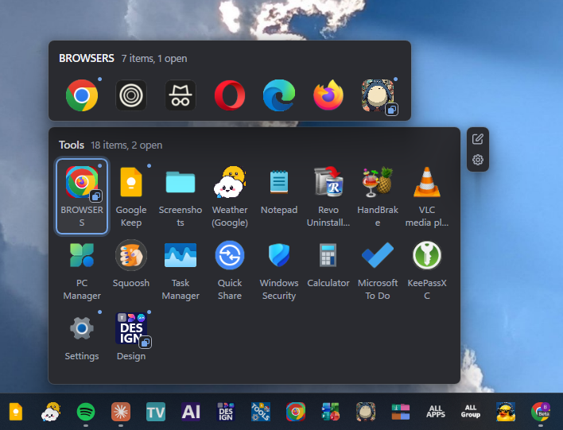
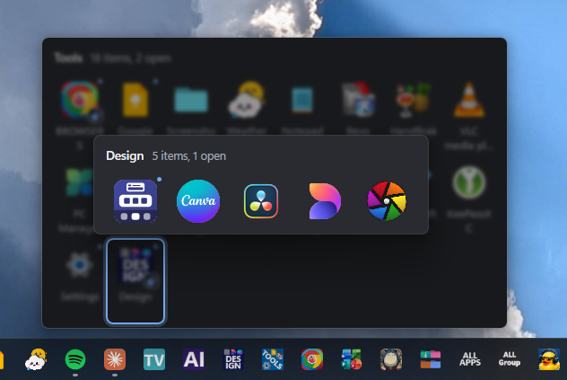
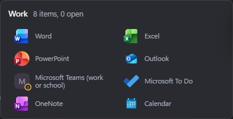
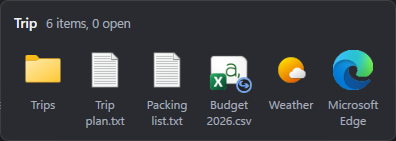
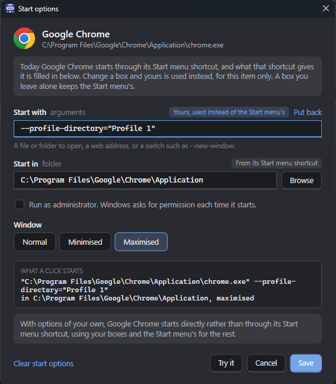
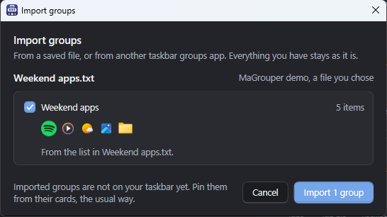
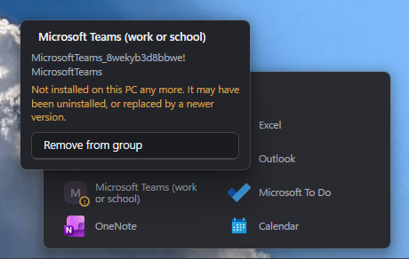

  

<h1 align="center">MaGrouper: Taskbar groups for Windows 11</h1>

  MaGrouper adds taskbar groups to Windows 11: pin a group of apps, folders and files to the taskbar, and click it to open them with live window previews.

  
  
  
  

<table>
<tr>
<th align="center">MaGrouper 2.2.0 &nbsp;(new)</th>
<th align="center">MaGrouper Classic 2.1.9</th>
</tr>
<tr>
<td align="center">Native C++ &middot; 3.9 MB download $3 once, every update included</td>
<td align="center">.NET / WPF &middot; about 48 MB download Free, no longer updated</td>
</tr>
<tr>
<td align="center"></td>
<td align="center"></td>
</tr>
<tr>
<td align="center"><a href="https://anythinguseful.dev/magrouper"><b>Buy MaGrouper 2.2.0</b></a></td>
<td align="center"><a href="../../releases/latest"><b>Download Classic free</b></a> (GitHub)</td>
</tr>
<tr>
<td align="center"><a href="https://anythinguseful.dev/magrouper/changelog/">2.2.0 release notes</a> &middot; <a href="https://anythinguseful.dev/magrouper/redownload/">Already bought it? Download again</a></td>
<td align="center"><a href="../../releases">Classic release notes</a></td>
</tr>
</table>

  No subscription, no account, no telemetry. The rest of this page describes 2.2.0.

  

  One click on a group icon. Recorded on a real Windows 11 taskbar.

---

## What it is for

Windows 11 gives you one row for pinned apps and no folders. Pin everything you use and the row runs out of taskbar; pin only a few and the rest live in the Start menu, two clicks away.

This app puts them in groups. A group is one icon on your taskbar, and behind it is a small panel holding the apps you put in it. A group can hold folders, documents and other groups as well as apps, and you decide what shape the panel is.

Nothing is replaced and nothing is patched: a group is an ordinary Windows shortcut with an icon of its own, so the taskbar treats it like any other pinned app.

---

## Everything you have, ready to drag

This is the whole of using it. Every app on your taskbar and every app installed on the machine, found for you and searchable, packaged apps and ordinary programs alike. Nothing to hunt down and no paths to type. Pin something new to the taskbar and it shows up here on its own, and a refresh button is there if you want to ask again.

Select what you want, with Ctrl or Shift for several at once, and drag them across as one stack. A run of apps lands in the order it was in, wherever you point it, and **anything you change here is easy to undo**.

  

**Add to a group from every tab.** Pick apps, folders or files in any tab and send them to a group with a button, no drag needed. **And add groups from a group's own Add panel**, so a group can go inside another one without leaving the page you are on.

---

## Groups inside groups

Put a group into another group and its icon sits in the flyout like any app. Click it and its own flyout opens from the first one, so one taskbar button can hold a whole tree: Work, and inside it Writing, Design and Code.

<table>
<tr>
<td width="53%"></td>
<td width="47%"></td>
</tr>
<tr>
<td align="center">A group inside Tools opens its own flyout from the first one.</td>
<td align="center">The flyout you came from dims behind the one you opened.</td>
</tr>
</table>

**Every level is a real group.** It keeps its own icon, its own shape and its own settings, and the pen and gear work at whichever level you are on.

**The same group can go in more than once**, and one group can sit inside as many others as you like.

---

## Every group gets a face

Templates and a free hand designer. These are real group icons off a real taskbar, composed at the size Windows asks for:

<table>
<tr>
<td align="center"></td>
<td align="center"></td>
<td align="center"></td>
<td align="center"></td>
<td align="center"></td>
<td align="center"></td>
<td align="center"></td>
<td align="center"></td>
</tr>
<tr>
<td align="center"><b>Text only</b></td>
<td align="center"><b>App grid</b></td>
<td align="center"><b>Grid plus text</b></td>
<td align="center"><b>One app</b></td>
<td align="center"><b>Your image</b></td>
<td align="center"><b>Your own design</b></td>
<td align="center"><b>Your own design</b></td>
<td align="center"><b>Your own design</b></td>
</tr>
</table>

Real group icons off one taskbar, composed by the app at the size Windows asks for. Nothing here was drawn for the screenshot.

**Text only icons are yours to tune**: the size and weight of the lettering, the corner rounding of the tile, and you can type the words straight onto the tile itself.

---

## Shape the flyout, from inside the flyout

A flyout used to be one row, always. Now it is whatever shape you want, and you change it by editing the real thing rather than a picture of it.

Open a group, press the pen, and the flyout itself becomes editable in place.

  

  The same group, reshaped by dragging its edge. Nothing opens, nothing is saved, and Esc puts it back.

<table>
<tr>
<td width="52%" valign="top">

**Drag an edge and the grid reflows.** One row becomes two, or five. You are dragging tiles into place rather than stretching a box, so the flyout only ever holds whole rows and never has empty space in it.

**Or make it a list.** Each app becomes a wide card with its name beside its icon, in one column or several, for groups where the names matter more than the pictures.

**Names, from five lines down to none.** A column of choices sits beside the flyout while you edit, and the lowest is **No names**: clean icons and nothing else.

**Hide the group's name, or type a new one** straight into the flyout.

**Tooltips on or off**, so a group can be as quiet as you like.

**Rearrange the apps** by dragging them, and take one out with the badge on its corner. Or **sort them** from the button beside the group's heading: A to Z, newest or oldest first, with apps, folders and files kept together in the order you choose, and your own order one click away.

**Undo and redo the whole time.** Enter or Done keeps the shape. **Esc puts it back exactly as it was.**

</td>
<td width="48%"></td>
</tr>
</table>

  

  The list view, in two columns. The dimmed Teams tile is an app that is no longer installed.

Every one of those is a global setting with a per group override, so your groups can all match, or each one can be its own thing. Where a flyout opens is yours too: centered on its button, lined up on its left hand app, or lined up on its right hand app.

---

## Change icon size

The apps in a flyout are drawn at four sizes, and the name follows the icon rather than being a second setting to keep in step. Pick one while the flyout is open and it changes in front of you, at the size it will really be, on the group you are really looking at.

  

  Press <b>Icon size</b> while editing a flyout. Every choice previews in place. The tick keeps it, Esc puts it back.

 

<table>
<tr>
<td align="center" valign="bottom"></td>
<td align="center" valign="bottom"></td>
<td align="center" valign="bottom"></td>
<td align="center" valign="bottom"></td>
</tr>
<tr>
<td align="center"><b>Small</b> 24pt</td>
<td align="center"><b>Default</b> 30pt</td>
<td align="center"><b>Large</b> 40pt</td>
<td align="center"><b>Extra large</b> 48pt</td>
</tr>
</table>

  One group, drawn four ways, shown at true relative scale.

<table>
<tr>
<td width="50%" valign="top">

**Four sizes, a button each.** Press one to pick between them, with no slider to nudge into place.

**The name follows the icon.** 10, 11, 12 and 13 point under 24, 30, 40 and 48, so a bigger icon never ends up with tiny writing under it.

</td>
<td width="50%" valign="top">

**Global, or per group.** Set it once for everything, or give one group a size of its own and leave the rest alone.

**Nothing moves unless you move it.** A flyout you have never told is drawn at exactly the size it always was.

</td>
</tr>
</table>

---

## Not only apps: folders and files

A group can hold a mix of apps, folders and documents. Click a folder and Explorer opens it; click a document and it opens in whatever normally opens it. There is nothing special about them once they are in, which is the point.

  

**Rename or move a file and the group follows it.** A file or folder that moves keeps working from its group, and a small mark tells you MaGrouper has followed it, so nothing changes behind your back.

<table>
<tr>
<td width="48%"></td>
<td width="52%" valign="top">

### A file browser built in

A third tab alongside your taskbar apps and everything installed. Quick access down the side with your standard folders, OneDrive, This PC and whatever Windows itself has pinned. A breadcrumb, a back arrow, search, headings you can sort by, columns you can drag wider, and a list or tiles at four sizes. Ctrl+A selects everything listed, or only the folders when it is showing folders only.

**Files draw their real picture**, the same thumbnail Explorer shows, and a video gets a strip of frames taken from inside it.

</td>
</tr>

<tr>
<td width="52%" valign="top">

### Or straight out of Explorer

Drag a file or a folder off a real Explorer window, or off your desktop, and drop it into a group. The same three places that already take a dragged app take a dragged file: a group's card, a group's own page, and the flyout itself.

Pick several with Ctrl or Shift and they travel together, and one drag is one press of Ctrl+Z.

</td>
<td width="48%"></td>
</tr>
</table>

  

  The budget was moved into another folder. The small blue mark says MaGrouper followed it.

---

## Start each app your way

Every app, file and folder in a group has its own start options, so one tile can open exactly the thing you want rather than the app's front door.

  

- **Start with**: the arguments the app is started with, such as a particular profile, playlist or project.
- **Start in**: the folder it starts in.
- **Run as administrator**, and Windows asks you once, as it should.
- **Window size**: normal, minimized or maximized.

**The same app can go into a group more than once**, each copy with its own start options. Two Chrome tiles, one for work and one for home, is one group.

---

## Bring your groups with you

**Export your groups to a file**, with your settings too if you want them, and import them on another PC.

**Or make a group from what you already have**: a folder, a handful of files, or a plain list with one path or app per line.

  

---

## Open a group your way

**Open on hover.** A group opens with a click by default. Switch on open on hover in settings and **resting the pointer on a group's button opens it**, no click needed. You choose how long the pointer rests first, and passing over the taskbar on the way somewhere else opens nothing.

**Right click a group's button for Open all.** Every app, folder and file in the group opens in one go, in the group's order. An app that is already open comes forward rather than opening twice, and a big group asks first. The same menu goes straight to the group's visual editor or its settings, and the flyout's own right click menu carries the same three.

---

## Groups on your desktop

**A group can sit on your desktop as well as, or instead of, the taskbar.** Choose **Add to desktop** from a group's ⋯ menu or from its right click menu in the Groups tab, or simply drag a group out of the window onto the desktop. Its icon is the group's own picture, and opening it shows the same flyout, right beside the icon.

**Put a desktop flyout anywhere.** In its visual editor, drag the grab bar and the flyout moves freely, to any edge or corner of the screen, and once it has moved you can resize it from all four sides. It remembers its spot, and a right click on the grab bar takes it back to where it started.

**Drop a group's desktop icon into any group** and it goes in as a group inside the group.

---

## What it does

<table>
<tr>
<td width="46%" valign="top">

### Live window previews

Hover an app that has windows open and you get a preview of each one, drawn by the same part of Windows the taskbar's own previews use. The title, the app's icon, and a close button on every one.

</td>
<td width="54%"></td>
</tr>

<tr>
<td width="46%"></td>
<td width="54%" valign="top">

### Peek at the real window

Rest on a preview and the window itself comes forward, full size, in its own place, over everything else. Move away and it goes back exactly as it was. Nothing is activated and nothing is resized. Off until you switch it on.

</td>
</tr>

<tr>
<td width="46%" valign="top">

### Draw the icon yourself

A real editor: layers of text, shapes, app icons and pictures, dragged around, resized by their corners, turned by a handle, in any color, at any weight. Sixty steps of undo, and the 16, 24, 32 and 48 pixel versions drawn underneath as you work.

</td>
<td width="54%"></td>
</tr>

<tr>
<td width="46%" valign="top">

### Change any app's icon

The same designer will rewrite the icon of an app that is not in any group, so your Start menu and taskbar show your picture instead of theirs. It says up front which apps Windows will allow this for, and it can put the original back exactly.

</td>
<td width="54%"></td>
</tr>

<tr>
<td width="46%" valign="top">

### Knows when an app has gone

Uninstall an app that is in a group and its tile dims and takes a small mark rather than turning into a blank square. Click it and you get the ways out: **Replace with** the newer version when MaGrouper can find one, or **Remove from group**. It never removes anything on its own.

</td>
<td width="54%"></td>
</tr>

<tr>
<td width="46%"></td>
<td width="54%" valign="top">

### Light, dark, and your call on everything

**There is a full light theme and a full dark one**, and it will follow Windows if you would rather not choose. Every screenshot on this page is the dark theme; the light one is the same app in daylight. Then: how many rows a flyout has and how many lines a name gets, whether it opens centered on its button or lined up on an app, what the other previews do when you close one, whether it starts with Windows. Every setting shows you a picture of what it does rather than describing it.

</td>
</tr>
</table>

---

## Making your first group

### 1. Drag some apps in

Everything on your taskbar and everything installed, searchable, plus a folders and files tab for anything else. Drag them across, or use the button.

  

### 2. Give it a face

Pick a template, drop in a picture, or open the designer and draw one.

  

### 3. Pin it

Save, and a small window holds your group's icon. **Drag it out of that window onto your taskbar**, where you want it to sit. If you would rather go through the shortcuts folder, there is a setting for that, and right click and **Pin to taskbar** works from there too.

  

> [!WARNING]
> **One thing is by hand, and it has to be.** Windows 11 does not let any program unpin a taskbar button, so the last step is yours: once your group is on the taskbar, unpin the apps you have just grouped. The app names exactly which icons to remove and reminds you on the way out.

---

## Performance and optimization

It is built to sit out of your way and answer the moment you click. This is MaGrouper rewritten in native C++: the same look and the same behavior as the C# version, with no runtime underneath it, so it starts faster, opens faster and holds a fraction of the memory.

> [!NOTE]
> **What these numbers were measured on**: an ordinary mid range laptop, an Intel Core i7-1165G7 with 16 GB of memory, on Windows 11 at 100% scaling. That is the same PC the C# version's figures came from, and both versions were measured by one script on the same day, on the same four groups of 8, 20, 142 and 215 apps made from that PC's Start menu. Every time is the app's own log line, written the moment the flyout is on screen. A newer PC will be quicker and one that is short of memory will be slower, but the shape is the same everywhere. These are one PC's results, not a promise: your times will depend on your hardware, but because the app does so little per click, a group should open in well under a tenth of a second on most PCs.

There are two kinds of open, and they are the only two times you will ever see:

- **A cold open** is the first click when MaGrouper is not running yet, after you sign in with "start with Windows" off, or after you have closed it.
- **A warm open** is every click after that, while MaGrouper waits quietly in the background.

### Opening a group

| Time to the flyout on screen | C++ version | C# version |
|---|---|---|
| **Cold open** | **About a fifth of a second** (164 to 231 ms over ten tries) | About 0.8 seconds |
| **Warm open**, 8 apps | **29 ms** | 54 ms |
| **Warm open**, 20 apps | **32 ms** | 69 ms |
| **Warm open**, 142 apps | **51 ms** | 177 ms |
| **Warm open**, 215 apps | **59 ms** | 228 ms |

Each warm figure is the middle of six opens. The C++ times start when the click's own small program starts, so they include handing the click over to the running app; the C# times start at the hand over itself, which leaves its launcher's start (about 17 ms) out. The C# cold open is the figure its own page gives for this PC: its launcher writes to your real groups folder, so the script does not run it.

### Sitting in the background

| | C++ version | C# version |
|---|---|---|
| CPU, nothing on screen | **None**: 0 ms in a minute | 78 ms in a minute |
| Memory it holds, after an 8 or 20 app group | **About 20 MB** | About 88 MB |
| Memory it holds, after the 215 app group | **About 57 MB** | About 112 MB |
| Task Manager's Memory column, two seconds after a flyout closes | **Under 1 MB** | Under 3 MB at first, about 20 MB a minute later |
| Background services | **None.** No service and no scheduled task | None |
| Added to your startup | **Nothing**, unless you switch that on yourself | Nothing |
| Network | One update check a day, and nothing else | The same |

"Memory it holds" is what Windows has given the app and not had back (private bytes), read three seconds after the flyout closes. Task Manager's Memory column shows only the part of that sitting in RAM at that moment, and both versions empty that two seconds after a flyout closes: the pages go back to Windows, so the column drops while the memory is still the app's. The C++ version keeps the parts it shares with Windows (its code and the system's fonts) in place, and since nothing in it runs while no flyout is open, the column stays under 1 MB until your next click. That click waits a few ms for its pages to come back: an open after the column has dropped takes 3 to 10 ms longer than the warm figures above.

### Size

| | C++ version | C# version |
|---|---|---|
| The setup program | **3.9 MB** | About 48 MB |
| On disk once installed | **About 6 MB** | About 160 MB |
| Files installed | **One program** and its menu icons | The program and about 240 runtime files |

### Optimization techniques

The same rule as the C# version: the standard techniques, applied where a measurement said they were needed, and every saving below is a before and after on the same PC.

- **No runtime at all.** The whole app is one 5.7 MB program in C++, with Windows' own C runtime underneath. There is nothing to start before your click is answered, which is most of why a cold open went from about 0.8 seconds to about a fifth of one.
- **One small program for every click.** A pinned group starts the same program, which hands the click to the copy already running down a named pipe and exits, before it has loaded anything it does not need. If no copy is running, that same process becomes the app.
- **Loading late.** The parts of Windows a click does not need are loaded only when something asks for them: the shell, COM and the drawing libraries after the click is handed over, the accessibility interface only when a screen reader asks, the network library only for the update check. Taking the drawing libraries off the click's own start made every warm open about 4 to 7 ms quicker.
- **Drawing without the graphics card's driver.** Every window is drawn in software and copied to the screen, so the graphics driver, which costs about 100 MB the moment it loads, never loads at all. The first open of a 14 app group went from **120 MB to 15 MB** with the warm open no slower.
- **Redrawing only what changed.** Each frame draws only the parts of the window whose pixels changed. A check mode draws every such frame whole as well and compares them, and it has never found a pixel out.
- **Event driven rather than polling.** Nothing ticks while no flyout is on screen, which is why the background figure is a measured zero rather than a small number.
- **Doing the slow first steps side by side.** On a cold open, the shell lookups for the clicked group's apps and the setting up of the drawing start the moment the groups are read, on threads of their own, while the rest of the start goes on, and the lookups run four at a time rather than one after another. That took a cold open from about 270 ms to about 190.
- **Doing the expensive work before the click rather than during it.** Once your first flyout is on screen, a background thread works out what everything in your other groups launches (197 apps in about one second here), so no other group pays for it on its first open.
- **Caching what Windows is slow to answer.** Every app's icon is read out of the shell once and kept, which is why a warm open is so quick, and why memory grows with the number of apps you have opened rather than with time.
- **UI virtualization.** The built in file browser builds only the rows you can see and a page either side, as the C# version's does.
- **Memory leaks checked for.** A flyout was opened and closed 5,000 times in a row: the memory grew by 0.2 MB over the last 2,500 opens, and the window, drawing and system handles it held were the same or fewer at the end than at the start.

### What it does cost

- **A very large group costs more**, as the table shows: 215 apps takes 59 ms where a dozen takes about 30.
- **An open after a pause is a few ms slower**, because two seconds after a flyout closes its pages are handed back to Windows, which is what keeps Task Manager's figure under 1 MB: 3 to 10 ms, depending on the size of the group.
- **Memory grows with what you have opened.** Each app's icon is kept once it has been read, so opening every app of a 215 app group takes the app from about 20 MB to about 57 MB, and it stays there rather than being read again.
- **A cold open after a long gap, on a machine short of memory, is slower**, because Windows has to read the program off the disk first. At 6 MB there is much less to read than there was. Turning on "start with Windows" moves that cost to sign-in.
- **None of these numbers is flattered by the build.** They were taken on a release build of the same code the setup program installs, which differs only in the names it gives its folder and taskbar identity.

---

## Getting it

MaGrouper is a **one-time purchase**: pay once and it is yours, with every future update, on every computer you use. There is no subscription, no account and no license key to type.

1. **[Buy it on anythinguseful.dev](https://anythinguseful.dev/magrouper).** Checkout is handled by Paddle, who take card, PayPal, Apple Pay and Google Pay and add the right sales tax for your country.
2. **Download your installer** from the page you land on after paying. The same link is in your receipt email and works for good: use it again for a new PC or a reinstall.
3. **Run it.** The wizard asks whether to install for everybody or just you, and where. The defaults are for all users and `C:\Program Files\MaGrouper`.

> [!TIP]
> **Already using the free C# version?** The installer asks whether to put MaGrouper beside it or replace it. Replace it and your groups, your pinned buttons and your settings all carry across.

> [!NOTE]
> **Lost the link?** Type your email at **[Download again](https://anythinguseful.dev/magrouper/redownload)** and it is sent to you. Receipts and invoices are in Paddle's customer portal, linked from the same page.

> [!NOTE]
> **Windows may warn you about this file.** It says "Windows protected your PC" because the installer is not yet signed by a paid code signing certificate. Choose **More info**, then **Run anyway**. Every buyer gets byte for byte the same file, and its SHA256 is printed on the download page: in PowerShell, `Get-FileHash .\MaGrouperSetup-*.exe -Algorithm SHA256` should match it character for character.

> [!TIP]
> **Updates are included, for life.** An installed copy checks once a day and tells you when there is a newer one. It downloads and installs nothing until you press the button on its own settings screen.

### What it needs

- Windows 11, 64 bit. It runs on Windows 10 but the taskbar behaves differently and is untested.
- Nothing else. There is no runtime to install, and none inside the installer either.
- About 6 MB on disk once installed.

---

## Worth knowing before you buy

Three of these are limits of the Windows 11 taskbar rather than of this app. They were each measured rather than assumed, and the app tells you about them in the moment instead of leaving you to work it out.

A pinned button keeps the picture it was pinned with

If you redraw a group's icon after pinning it, the taskbar goes on showing the old one. That is Explorer's own copy of the button, and nothing a program may do will shift it: rewriting the icon, the shortcut, the pinned copy and three different shell notifications were all tried on a real taskbar and photographed. Unpin and pin again, or sign out. The app says exactly this, at the moment it matters.

Pinning is a drag, and unpinning is yours to do

Saving a group opens a small window holding its icon, and **you drag that onto your taskbar and drop it where you want it**, which also chooses its position in the row.

There is a setting that goes the older way instead: the shortcuts folder opens with the group's shortcut already selected, and you drag it out of there or right click and choose Pin to taskbar.

Unpinning is entirely by hand either way, because no program may unpin a taskbar button on Windows 11, and the app names which icons to remove.

It is not a taskbar replacement

Nothing is injected into Explorer, no shell extension is registered, and the taskbar is not modified. A group is a shortcut with a composed icon, and the panel is an ordinary window this app draws above the taskbar. If you uninstall it, your taskbar is exactly as it was.

What it does with your data, which is nothing

No account, no telemetry, no analytics. Your groups live in one readable file under your own app data folder. The only thing it ever sends is a once a day request to anythinguseful.dev asking what the newest version is, and, only when you press Update, your order's code so the update can be downloaded. It does not start with Windows unless you switch that on, or switch on open on hover, which turns it on for you and says so.

Uninstalling takes its things with it

The uninstaller offers to remove your groups, the icons it composed and the shortcuts it wrote, and it puts back the icon of any other app you changed with it, which is the one leftover a general uninstaller could never fix. Say no and everything stays where it is. Export your groups first if you might want them back.

---

## Questions

How much is it, and what do I get?

$3, once. Every future update, on every computer you use, with no subscription, no account and no license key. Full refund within 14 days, no questions asked.

Is there still a free version?

Yes. MaGrouper Classic 2.1.9, the original C# version, stays free on the [releases page](../../releases/latest). It won't be updated again; new features such as groups on the desktop are in 2.2.0.

How is it different from Taskbar Groups and other taskbar group apps?

There is a fair side by side comparison, including the free and open source options, at [anythinguseful.dev/magrouper/taskbar-groups-alternative](https://anythinguseful.dev/magrouper/taskbar-groups-alternative/).

Windows says "Windows protected your PC"

The installer is not signed with a paid certificate yet. Choose **More info**, then **Run anyway**. Every buyer gets the same file.

I lost my download, or I have a new PC

Type the email you bought with at [Download again](https://anythinguseful.dev/magrouper/redownload) and your link is emailed to you. It never expires.

More answers are in the [FAQ](https://anythinguseful.dev/magrouper/faq/).

---

## License and copyright

Copyright (c) 2026 Noah P Davidson. All rights reserved.

**MaGrouper is paid software and is not open source.** One purchase covers one person on as many computers as they own or use, at home or at work. What you may not do is share your download link, sell it, repackage it, rebrand it, or publish it anywhere else. The full license is shown by the installer and summed up in the [terms](https://anythinguseful.dev/magrouper/terms/), beside the [refund policy](https://anythinguseful.dev/magrouper/refunds/) and [privacy policy](https://anythinguseful.dev/magrouper/privacy/). [LICENSE.txt](LICENSE.txt) in this repository is the license of the free Classic version.

**It is sold in one place: [anythinguseful.dev](https://anythinguseful.dev/magrouper).** If you find it on a download portal, a mirror, a torrent or any other app store, that copy did not come from here, nobody has checked what is in it, and I would be glad to hear about it on the [issues page](../../issues).

> [!NOTE]
> **The free C# version, MaGrouper Classic 2.1.9, stays free** on the [releases page](../../releases/latest). It has everything up to 2.1.9, and it will not be updated again. Its original page is kept in full in [README-CLASSIC.md](README-CLASSIC.md). Groups on the desktop, the speed and memory figures above, and every new feature from here on are in the paid version. The paid version's installer can replace the classic one and keep all your groups.

> [!NOTE]
> **The "Source code" archives on a release are not the source code of the app.** GitHub attaches a zip and a tar.gz to every release automatically, and they hold a copy of *this repository*, which is this page and its pictures. The app is not open source and its code has never been in here.

---

  Built for Windows 11. <a href="https://anythinguseful.dev/magrouper">Buy it</a>, report a problem on the
  <a href="../../issues">issues page</a>, or read what changed in the
  <a href="https://anythinguseful.dev/magrouper/changelog">release notes</a>.

